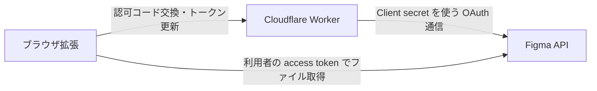

# Figma OAuth Client secret を Cloudflare Workers に移す計画

作成日: 2026-11-05。今回は設計まで。Worker の作成・デプロイ、認証コード変更、鍵の更新はまだ実行しない。

## 推奨する最小構成

Cloudflare Workers Free の Worker を 1 つ使い、ログイン時の認可コード交換とトークン更新だけを中継する。DB、KV、Durable Objects、独自ドメインは最初は使わず、標準の workers.dev ドメインで始める。

目的は、全利用者で共通の Figma OAuth Client secret を配布 ZIP から取り除くこと。Client ID、Worker URL、拡張 ID は公開情報でよい。利用者の access/refresh token は引き続き拡張に保持するため、端末上のトークン窃取まで防ぐ設計にはならない。

利用者のトークンもすべてサーバーに置く要件になれば、セッション管理・永続化・全 API の中継が必要になる。今回は無料・簡単に運用する目的に合わせ、そこまでは広げない。

## 現状の問題と変更範囲

- `src/lib/oauth.svelte.ts` が `WXT_FIGMA_SECRET` をビルド時に読み、認可コード交換と更新リクエストの Basic 認証に使っている。GitHub Secrets に入れても、ここで配布 JS に埋め込まれる。
- `WXT_FIGMA_ID` は OAuth Client ID なので秘匿不要。Chrome ストア申請用サービスアカウントの秘密鍵は申請ステップだけに渡されており、今回調べた埋め込み問題とは経路が異なる。
- `access_token`、`refresh_token`、`expires_at` がユーザー設定と一緒に `sync:options` に保存されている。OAuth 移行時に認証情報を `local:auth` へ分離し、表示設定等の同期は維持する。
- 認証情報を分離する際は OAuth ファイルだけでなく、`src/types.ts`、`store.svelte.ts`、`Layout.svelte`、`TeamSetting.svelte` と全 `sync:options` 書き込み箇所を見直す。UI が旧形式のトークンを同期ストレージへ再保存しないようにする。

## Worker の契約

| エンドポイント案 | 入力 | 処理 |
| --- | --- | --- |
| `POST /oauth/exchange` | `code`, 許可済みの `redirect_uri` | 固定の Figma token エンドポイントへコード交換を依頼 |
| `POST /oauth/refresh` | `refresh_token` | 固定の Figma refresh エンドポイントへ更新を依頼 |
| `GET /health` | なし | 外部 API を呼ばず起動確認。秘密情報や設定値は返さない |

Worker 側の設定は非秘密の `FIGMA_CLIENT_ID` と、Worker Secret の `FIGMA_CLIENT_SECRET`。拡張のビルド設定は公開可能な `WXT_FIGMA_ID` と `WXT_AUTH_BASE_URL` にする。Worker は必要な token 応答項目だけを返し、Figma のエラー本文や認証ヘッダーをそのまま転送しない。

ログイン画面の起動は既存の `identity.launchWebAuthFlow()` を使う。拡張が生成した `state` とコールバックの origin/path を検証してから Worker に認可コードを送る。Worker に汎用の URL 中継機能は作らず、送信先、Client ID、スコープ、受け入れる redirect URI を固定する。

### 公開エンドポイントとしての保護

- コード交換には Figma が検証する有効な認可コード、更新にはその OAuth アプリに属する有効な refresh token が必要。これらを利用者単位の資格情報として扱う。任意のコードやトークンを指定しても Figma 側で拒否されることをテストする。
- 拡張へ共通の「Worker 用 API キー」を埋め込む方法は使わない。再び誰でも取り出せる鍵になる。
- CORS の許可は必要な拡張 origin に限定し、任意 origin の反射や `*` は避ける。ただし Origin はブラウザ外で偽装できるため、CORS を利用者認証の代わりにはしない。Chrome/Firefox の実際の Origin ヘッダーの有無を確認して、必要な扱いを決定する。
- 本番 Chrome の redirect URI は `identity.getRedirectURL()` の実測値を登録し、完全一致で検証する。開発用・Firefox 用は個別に確認して追加し、ワイルドカードにはしない。
- POST/JSON のみ、入力サイズ上限、上流通信のタイムアウト、IP 単位等のレート制限、`Cache-Control: no-store` を設ける。Cloudflare の Rate Limiting API は拠点ごとの概算制限であり、厳密な全世界合算上限ではない。
- 認可コード、Client secret、access/refresh token を URL・ログ・例外メッセージ・トレースに入れない。記録するのは操作種別・結果・所要時間・リクエスト ID 程度にする。Worker はトークンを DB に保存しないが、交換・更新時に通過するため新たなデータ処理主体になる。
- Figma の PKCE 対応と Client secret 要否は、実装開始時に公式資料と実機で確認する。今回は公式認証ページがネットワーク制限で読めず、OpenAPI でも PKCE 対応は確認できていない。PKCE を使えば secret が不要になるとは断定しない。対応していれば S256 を使い、未対応なら既存の confidential-client 方式を Worker に移す。

## 実装の順序

### 1. Worker の準備

`workers/figma-auth/` に TypeScript の Worker、Wrangler 設定、単体テストを追加する。公開するのはソースコードだけで、秘密情報は Cloudflare ダッシュボードまたは Wrangler の Secret 機能で登録する。ローカルの `.dev.vars*` は必ず Git と配布 ZIP の対象外にする。

Cloudflare アカウントで Workers Free を選び、本番と開発の設定を分ける。まずローカルとテスト用アプリでコード交換・更新・失敗ケースを検証し、最初のデプロイは手動にする。Cloudflare のデプロイ用トークンを GitHub に追加する自動化は必要になってから行う。

### 2. 拡張を接続

コード交換と更新の fetch 先を Worker へ変更する。Figma の `/me`、チーム・プロジェクト・ファイル取得は現在どおり直接通信する。Worker の HTTPS ホストを必要最小限の host permission として追加する。`tabs` と `activeTab` は復活させない。

`WXT_FIGMA_SECRET` と Basic 認証を拡張側から完全に削除し、GitHub Actions のビルド注入・必須設定チェック・ドキュメントも更新する。トークンを `local:auth` に分離し、同期済みの旧認証情報は移行成功後に削除する。元の保存情報を途中で壊さず、全書き込み箇所と複数アカウントでの競合をテストする。

refresh token が更新応答でローテーションした場合は新しい値を保持する。複数画面による同一アカウントの同時更新を直列化し、古い refresh token の上書きを防ぐ。失敗時はリトライを無限に続けず、再ログインを案内する。

### 3. 配布物への秘密情報混入を防止

CI のテスト用ビルドに公開してよい固有のダミー secret を渡し、最終 JS・ZIP・ソース ZIP の中に原文や想定されるエンコード結果が入っていないことを検証する。実キーはテストに使わず、検索で検出した値をログに表示しない。

以後の本番ビルドでは `WXT_FIGMA_SECRET` を渡さない。Client ID と Worker URL だけで Chrome/Firefox ビルドが通ることを確認する。

### 4. 公開済みの鍵を更新して移行を完了

現在の secret は既存の配布物から取得できるため、外に出たものとして扱う。Worker に同じ値を移しただけでは、既存 ZIP から取得できる問題は終わらない。

Worker と新拡張を準備してテストし、新版の配布に合わせて Figma 側の Client secret を更新・旧値を無効化する。新しい値は Worker Secret だけに置き、GitHub の旧 `WXT_FIGMA_SECRET` は不要になった時点で削除する。旧ビルドと旧 Artifact の保存範囲も整理するが、すでにダウンロードされた鍵は取り消せないためローテーションが必要。

Figma が鍵更新後に既存の access/refresh token を有効とするか、複数 secret の併用が可能かは事前確認する。旧版のログイン・トークン更新が止まる可能性を見込み、更新・再ログインの案内を用意する。ロールバックでも漏れた旧 secret を復活させたり、拡張へ再埋め込みしたりしない。

次回からは `DEFAULT_PUBLISH` で承認後自動公開するため、Worker の本番準備と鍵更新時刻を拡張の申請前に決める。審査待ちの間に配布準備を済ませ、公開直後に動く構成にする。

## 無料枠と運用

確認した公式資料では Workers Free はアカウント全体で 100,000 リクエスト/日、CPU 10ms/呼び出し。外部 API の応答待ちは CPU 使用時間とは別であり、今回の短い中継処理を無料枠で運用できるか実測する。DB・独自ドメイン・有料プランは不要。

リクエスト数はログイン・更新・プリフライト・ヘルス確認等の合計になる。例えば 1,000 人が各 1 時間に 1 回更新すると更新だけで約 24,000 件/日だが、実際の更新間隔は Figma の `expires_in` に従う。他の Workers の利用分や攻撃リクエストも同じ無料枠を消費する。

無料枠を超えると新規ログイン・更新が失敗するため、使用量とエラー率を確認できるようにする。有効期限内の access token による直接のファイル取得は Worker 障害の影響を受けにくい。無料で無制限とは見なさず、有料への自動移行は設定しない。Figma 自体の API レート制限は別途適用される。

## 完了条件

1. 拡張・配布 ZIP・ソース ZIP に共通の Client secret が含まれない。
2. ログイン、複数アカウント追加、更新・ローテーション、ログアウトが実機で通る。
3. state 不一致、外国の redirect、無効コード/トークン、過大入力、上流 429/5xx、タイムアウト、制限超過が適切に失敗し、秘密情報がログや応答に出ない。
4. 同期ストレージへのトークン書き込みがなくなり、移行中断・再実行・複数画面の競合を扱える。
5. 新版を申請する前に、プライバシーポリシー、Chrome ストアの認証情報・第三者処理の開示、`CHROMEWEBSTORE.md`、`AGENTS.md`、現状の挙動と一致しない `SECURITY.md` の説明を更新する。
6. 旧 Client secret が無効になり、Worker 側の新 secret で運用できる。公開済み旧版への影響も確認する。

## 実装時に必要なユーザー作業

Cloudflare アカウントと Worker 名の確定、Figma OAuth アプリ設定・鍵更新、Worker Secret の安全な登録、必要なプライバシー情報の公開。秘密値はチャットに貼らず各サービスの設定画面で登録する。今回の計画段階で追加の資格情報は不要。

## 根拠と未確認事項

- [Workers の料金](https://developers.cloudflare.com/workers/platform/pricing/)
- [Workers の制限](https://developers.cloudflare.com/workers/platform/limits/)
- [Worker Secrets](https://developers.cloudflare.com/workers/configuration/secrets/)
- [Rate Limiting API](https://developers.cloudflare.com/workers/runtime-apis/bindings/rate-limit/)
- [Figma OpenAPI](https://github.com/figma/rest-api-spec/blob/main/openapi/openapi.yaml): 認可・交換・更新エンドポイントを確認。
- [Figma 認証ドキュメント](https://developers.figma.com/docs/rest-api/authentication/): 今回はアクセス制限で未読。PKCE、secret 更新時のトークンの扱いは実装前の確認事項。

Cloudflare の記述は同社公式 cloudflare-docs リポジトリの公開原稿を 2026-11-05 に取得して確認した。実際のアカウント設定・利用量・Figma のライブ OAuth は未検証。
